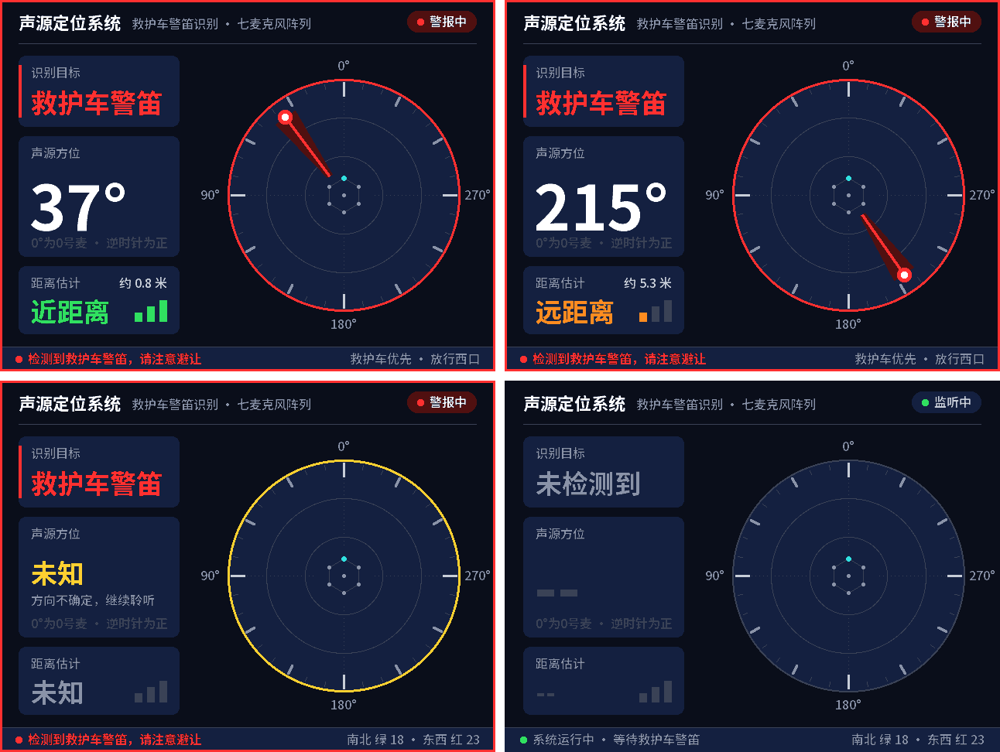

# 应急车辆"声学让行"路侧协同终端

路口的麦克风阵列听到救护车警笛，判断来车方向，再控制信号灯提前放行：不需要车辆主动上报任何信息。

*Acoustic emergency-vehicle priority at intersections: a 7-microphone array on a Zynq-7020 detects a siren, estimates its direction, and drives traffic lights to give that approach a green. Bare-metal C on the ARM cores, I2S capture and HDMI output in Verilog. Documentation is in Chinese.*

> ⚠️ **这是课程 / 竞赛原型，不能用于真实路口。** 信号灯逻辑只驱动演示用的 LED。
> 警笛识别是规则算法，尚未验证能区分救护车与警车、消防车，也没有做过实际道路测试。

| HDMI 主界面 | OLED 倒计时（代替数码管） |
|---|---|
|  |  |

*以上为 PC 上渲染的预览图。*

## 功能

- **声源定位**：7 路麦克风同步采集，1024 点 FFT + GCC-PHAT + SRP，每约 21 ms 输出一次方位。
- **警笛识别**：按音调强度、频率起伏、响度稳定性和持续时间判断，并抑制人声、喇叭、音乐、持续噪声的误报。
- **抗干扰定位**：按方向分别跟踪音调分量，只用"听起来像警笛"的方向的谐波频点定位，干扰更响或比警笛先响都不会把方向带走。
- **距离估计**：按警笛自身音量估算（近 / 中 / 远 + 大约米数），需要先在 1 米处标定。
- **信号灯优先**：来车方向是绿灯就保持（绿灯延长）；是红灯就让当前绿灯提前结束（红灯早断），经黄灯和全红后放行。
- **显示**：HDMI 640×480 中文界面、OLED 倒计时、SK9822 灯环指示方向、串口日志。

## 验证状态

最后一次更新：2026-10-24。

| 内容 | 状态 |
|---|---|
| PC 回归测试（`gen_test.py`，含合成干扰、噪声、交通声、移动声源） | ✅ 全部通过 |
| 信号灯状态机的安全不变量（PC 随机测试） | ✅ 通过 |
| 板上正常信号灯循环 | ✅ JTAG 读取输出寄存器确认 |
| 板上 HDMI 画面与自启动（QSPI） | ✅ 用户确认 |
| 板上救护车优先放行全流程、OLED 倒计时、串口 `C` 标定命令 | ⚠️ 未验证 |
| 真实房间的方向精度 | ⚠️ 未标定：一段标注 0° 的实录测得约 150°，原因未查明（摆放误差或房间反射） |
| 真实交通声的误报率 | ⚠️ 只用合成交通声测过 |
| 区分救护车与警车、消防车 | ❌ 未实现 |

合成测试没有房间混响，结果不代表实际环境中的精度。开发过程、失败的方案和测试数据见 [HANDOFF.md](HANDOFF.md)。

项目构想中的 FIR 带通滤波 FPGA 实现、RK3576 / Linux 分类模型和 CAN 接口尚未实现。目前警笛识别和定位都运行在 ARM 上，FPGA 负责同步采集、DMA 传输和 HDMI 输出。

## 硬件

- 正点原子启明星 ZYNQ7020 开发板（XC7Z020CLG400-2）
- Sipeed 6+1 麦克风阵列（7×MSM261S4030H0，I2S；12×SK9822 灯环）
- 0.96 寸 I2C OLED（SSD1306，128×64）
- HDMI 显示器
- 红绿灯模块或 LED（最多 4 组红 / 黄 / 绿 + 1 个指示灯）

## 系统结构

```
麦克风阵列 ─I2S─▶ PL: mic_array_i2s_rx ─AXIS─▶ AXI DMA ─HP0─▶ DDR（双缓冲）
                                                                  │
                                                  PS (Cortex-A9，裸机)
                  doa_process → siren_focus_apply → sc_process → target_output_update
                                                                  │
          ┌──────────────┬───────────────┬───────────────┬────────┴──────┐
       HDMI 帧缓冲    信号灯状态机      OLED 倒计时     SK9822 灯环    串口日志
       (rtl/hdmi_fb)  (AXI GPIO→LED)    (I2C0/EMIO)    (AXI GPIO)     (UART0)
```

- PL 时钟 50 MHz，SCK 3.125 MHz，采样率 48.828 kHz，7 路同步 24 bit。
- 每 1024 帧（约 21 ms）一个 DMA 包，每包处理一次。

## 接线

全部接底板扩展口 J4（2×20 排针）。奇数脚和偶数脚各在一排。接线前请对照丝印确认 1 脚位置，并用万用表确认 38 脚是 3.3 V、40 脚是 5 V。

### 麦克风阵列与 OLED

| 阵列引脚 | 信号 | J4 脚 | FPGA |   | OLED | J4 脚 | FPGA |
|---|---|---|---|---|---|---|---|
| 1 VIN | 电源 | 40（+5V） | — |  | GND | 37 | — |
| 2 GND | 地 | 39 | — |  | VCC | 38（+3.3V） | — |
| 8 MIC_CK | 串行时钟 | 1 | V5 |  | SCL | 8 | V8 |
| 7 MIC_WS | 字选择 | 3 | U5 |  | SDA | 10 | U8 |
| 3 MIC_D0 | 0/1 号麦数据 | 5 | V7 |  | | | |
| 4 MIC_D1 | 2/3 号麦数据 | 7 | W8 |  | | | |
| 5 MIC_D2 | 4/5 号麦数据 | 9 | U9 |  | | | |
| 6 MIC_D3 | 中心麦数据 | 11 | U10 |  | | | |
| 9 LED_CK | 灯环时钟 | 4 | T5 |  | | | |
| 10 LED_DA | 灯环数据 | 6 | U7 |  | | | |

- 先确认阵列板上麦克风的 VDD 是 3.3 V，再接数据线。
- 灯环由 5 V 供电时，3.3 V 信号可能驱动不了（不亮或乱闪）；此时把 VIN 改接 38 脚的 3.3 V。这只影响灯环。
- 不要使用 J4.2，它与摄像头接口共用。J4.27~36 同样与摄像头共用。

### 路口信号灯

高电平点亮。灯的公共 GND 接 J4.37 / 39（可用面包板分出）。裸 LED 须串 330 Ω~1 kΩ 电阻，IO 驱动电流不超过 8 mA。

| 信号 | J4 脚 | FPGA |   | 信号 | J4 脚 | FPGA |
|---|---|---|---|---|---|---|
| 北口 红 | 12 | T9 |  | 南口 红 | 13 | W6 |
| 北口 黄 | 14 | V6 |  | 南口 黄 | 15 | Y7 |
| 北口 绿 | 16 | Y6 |  | 南口 绿 | 17 | Y9 |
| 东口 红 | 18 | Y8 |  | 西口 红 | 19 | W10 |
| 东口 黄 | 20 | W9 |  | 西口 黄 | 21 | V11 |
| 东口 绿 | 22 | V10 |  | 西口 绿 | 23 | Y13 |
| 优先放行指示 | 24 | Y12 |  | 备用 | 25 / 26 | Y11 / W11 |

**方向约定**：阵列 0 号麦克风（0°）朝北，方位逆时针为正，所以 90° 为西、180° 为南、270° 为东。朝向不同时改 `sw/src/traffic_light.h` 的 `TL_NORTH_AZ_DEG`。灯模块低电平点亮时改 `sw/src/main.c` 的 `TL_OUT_INVERT`。

### HDMI

使用底板 HDMI 口。建议用 DC 适配器供电，并在断电时插拔 HDMI 线（开发中曾在接入显示器后出现一次 PL 掉配置）。

## 构建

需要 Vivado / SDK 2018.3。以下命令假设已安装到 `D:\Xilinx`，路径不同请自行替换。

```bat
cd vivado
D:\Xilinx\Vivado\2018.3\bin\vivado.bat -mode batch -nojournal -nolog -source create_project.tcl
D:\Xilinx\Vivado\2018.3\bin\vivado.bat -mode batch -nojournal -nolog -source build.tcl

cd ..\sw
D:\Xilinx\SDK\2018.3\bin\xsct.bat create_sdk.tcl
```

> 用 `-log` 把日志写到临时目录时，`create_bd_design` 曾反复报 `couldn't read file ...: No error`。原因未查明，去掉 `-log` 后正常。

### 下载运行

把启动拨码开关拨到 JTAG（两位都 ON），连接 JTAG 后：

```bat
cd sw
D:\Xilinx\SDK\2018.3\bin\xsct.bat run_on_board.tcl
```

串口用板载 USB_UART（115200 8N1）。跳线帽 P5 必须插在 UART1 一侧，否则收不到程序输出。

### 上电自启动（烧写 QSPI）

拨码开关在 JTAG 位置时：

```bat
cd sw
D:\Xilinx\SDK\2018.3\bin\xsct.bat make_boot.tcl
```

完成后断电，把拨码改为开关 1 ON、开关 2 OFF，再上电即自动运行。改代码后要重新执行（只改软件时先运行 `rebuild_app.tcl`）。

## 上板标定

1. **确认采集**：串口每秒一行 `LVL,ch0,...,ch7,耗时us,overrun`。安静时 7 个通道电平接近，ch6 是空声道，固定 -200。某通道也是 -200 说明数据线没接好。
2. **确认方向**：在已知方向拍手或放警笛。转向反了改 `DOA_MIC_DIR`，有固定偏差改 `DOA_MIC0_ANGLE_DEG`（`sw/src/doa_config.h`）。
3. **标定距离**：喇叭放在 1 米处播放警笛，屏幕显示识别到后，在串口发送字母 `C`。应收到 `CAL,OK,...`。标定值断电丢失，换音量后要重新标定。房间里超过约 1~2 米后，反射声会使远处的距离估得偏小。

串口输出的格式见 `sw/src/main.c` 文件头。

## 测试

需要 Python（numpy、scipy、Pillow）和 gcc。默认使用 Vivado 自带的 MinGW，可用环境变量 `GCC` 指定其他路径。

```bat
python sw/test/gen_test.py          :: 全部算法回归，含 interference_test.py 和信号灯状态机
python sw/test/preview_hdmi.py      :: 生成 docs/hdmi_preview.png
python sw/test/preview_oled_tl.py   :: 生成 docs/oled_tl_preview.png
sim\run_sim.bat                     :: PL 采集模块仿真（xsim）
sim\run_sim_hdmi.bat                :: HDMI 输出仿真（xsim）
```

修改 HDMI / OLED 上的中文后，要运行 `python tools/gen_cjk_font.py` 重新生成字库。它需要系统中有 Noto Sans SC 字体（`C:\Windows\Fonts\NotoSansSC-VF.ttf`）。

## 录制数据

录音不包含在仓库中，原因见 [rec/README.md](rec/README.md)。开发板运行时可以经 JTAG 读取原始数据：

```bat
python tools/rec_dump.py --continuous
python tools/rec_dump.py rec/my_capture.npz
```

也可以双击 `开始标注采集.cmd`，按中文菜单录制带标签的数据。`tools/train_ambulance.py` 是 PC 上的离线训练流程（逻辑回归基线），尚未部署到板上。工具默认的 Xilinx 路径可用环境变量 `XSCT`、`ARM_NM` 覆盖。

## 目录

| 路径 | 内容 |
|---|---|
| `rtl/` | I2S 采集（`mic_array_i2s_rx.v`）、HDMI 帧缓冲与 TMDS 输出（`hdmi_fb.v`） |
| `constr/sound_loc.xdc` | 引脚与时序约束 |
| `vivado/` | 创建工程、Block Design、综合实现脚本 |
| `sim/` | PL 模块仿真 |
| `sw/src/doa.c` | 定位算法（FFT、GCC-PHAT、SRP、谐波聚焦） |
| `sw/src/siren_focus.c` | 按方向跟踪音调分量、选择警笛方向 |
| `sw/src/sound_class.c` | 警笛识别、距离估计 |
| `sw/src/target_output.c`、`dir_filter.c` | 方向确认、显示稳定 |
| `sw/src/traffic_light.c` | 信号灯状态机 |
| `sw/src/hdmi_*.c`、`oled_*.c`、`sk9822.c` | 显示与灯环驱动 |
| `sw/src/doa_config.h` | 全部算法参数 |
| `sw/test/` | PC 端测试与预览 |
| `tools/` | 串口查看、录音读取、标注采集、字库生成、离线训练 |

## 许可证

代码采用 [MIT](LICENSE)。HDMI / OLED 字库 `sw/src/hdmi_font.c` 由 Noto Sans SC 生成，按 [SIL OFL 1.1](licenses/OFL-1.1.txt) 授权。详见 [THIRD_PARTY_NOTICES.md](THIRD_PARTY_NOTICES.md)。
